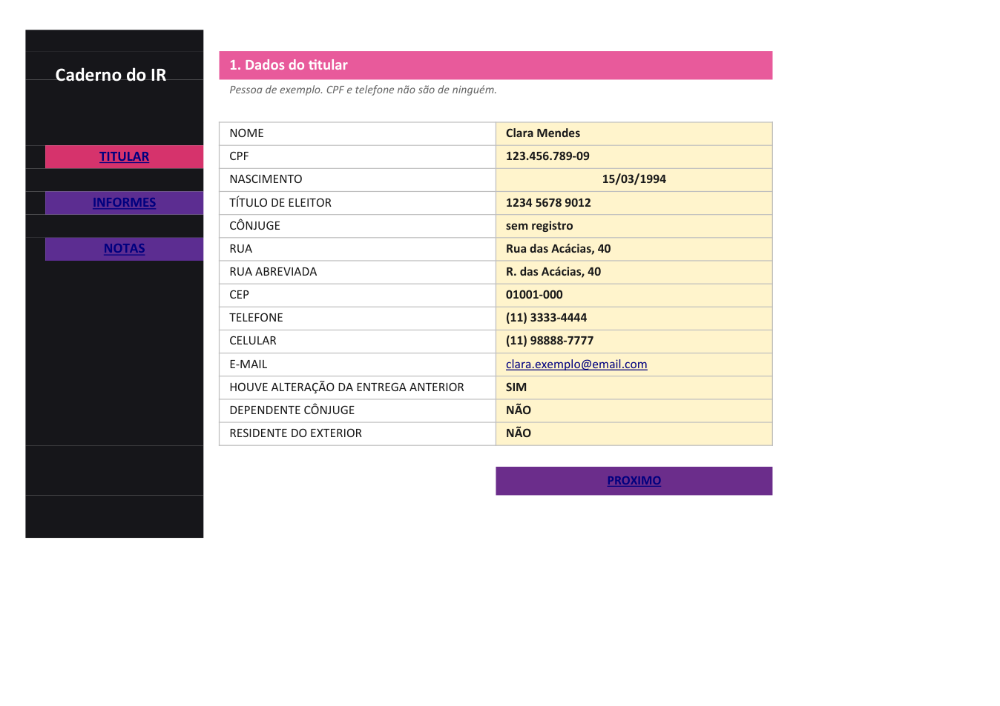
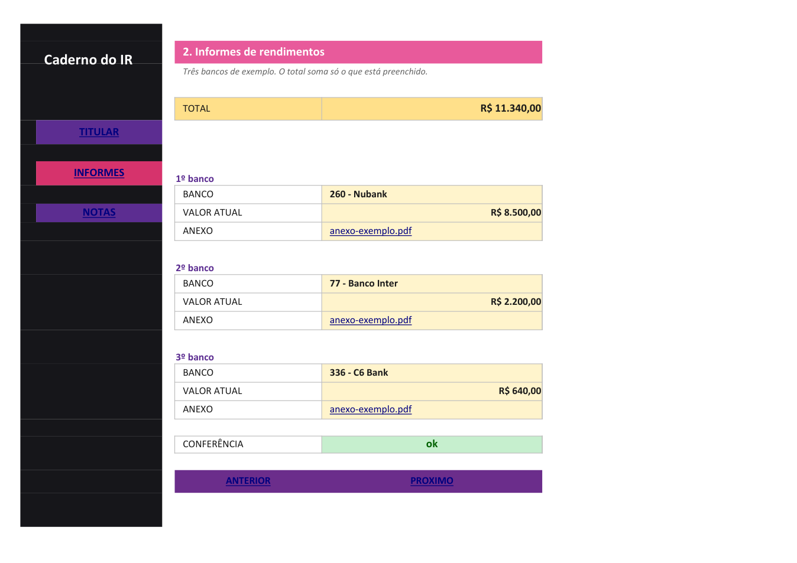
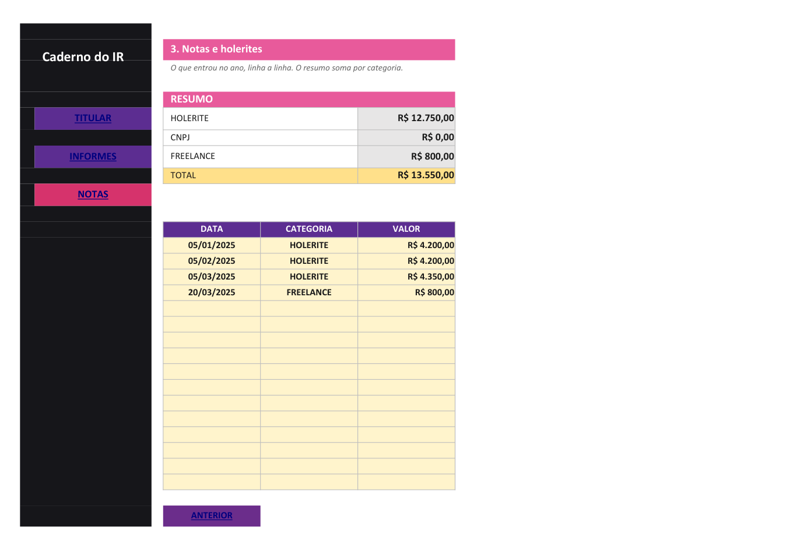

# Caderno do IR

A declaração junta três coisas que eu sempre espalho: quem é a pessoa, o informe de cada banco e o que entrou mês a mês. Separei isso em três telas, com um menu do lado, no mesmo desenho da aula. Sem leão e sem dado de gente famosa. O CPF e o telefone são de exemplo.

Arquivo: `planilha/caderno-ir.xlsx`. Abre no Excel e no LibreOffice. Célula amarela eu preencho. Célula cinza a planilha calcula. O menu rosa é a tela em que eu estou.

## As três telas

**Titular.** Nome, CPF, nascimento, título, cônjuge, endereço e contato. As três perguntas de sim ou não (mudou desde a última entrega, dependente cônjuge, mora fora) só aceitam esses dois valores. O e-mail é link.

**Informes.** Três bancos, escolhidos na lista da aba de apoio. No exemplo: Nubank R$ 8.500, Inter R$ 2.200, C6 R$ 640. O total em cima é a `SOMA` desses três, R$ 11.340. Se eu repetir o mesmo banco, a conferência deixa de marcar `ok`. O anexo aponta para `planilha/anexo-exemplo.pdf`, que não é informe de verdade.

**Notas.** Data, categoria e valor. A categoria só entra como HOLERITE, CNPJ ou FREELANCE. O resumo usa `SOMASE`: holerite R$ 12.750, freelance R$ 800, CNPJ R$ 0. O total das notas é R$ 13.550, a soma dessas três linhas, não uma conta solta.

## O macro do ícone

A aula tem um VBA que procura um desenho chamado `Ícone 1` e empurra ele para uma posição fixa. O texto que circula às vezes chega com o nome corrompido, e aí o macro não acha nada. Além disso o LibreOffice não roda VBA. Por isso o menu aqui é hiperlink: Titular, Informes, Notas, anterior e próximo. O código da aula, com o nome corrigido, ficou em `docs/mover-icone.bas` só para consulta.

## O que eu mudei

A estrutura é a da aula: menu, titular, informes com total, notas com categoria. Mudei o nome para Caderno do IR, troquei os dados de exemplo, somei as notas por categoria e coloquei a conferência de banco repetido. A navegação não depende do macro.

## Prints

